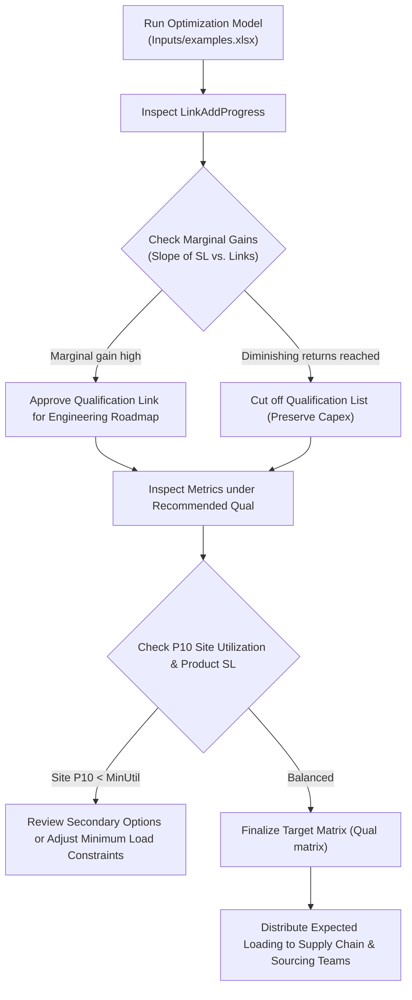

# Tying-The-Rope: Problem Formulation, Model Parameters, and Decision Framework

## 1. Problem Definition

### 1.1 Business Context: Manufacturing Network Flexibility
In high-tech and semiconductor manufacturing (e.g., wafer fabrication, memory packaging, assembly, and testing), a firm produces a diverse portfolio of products across multiple geographically distributed manufacturing sites (both internal factories and external OSAT partners).

Before any site can manufacture a specific product, that site must be formally **qualified** for the product. Qualification entails substantial financial and operational overhead:
- **Capital Expenditure (CapEx)**: Tooling, fixtures, test heads, and dedicated probe cards.
- **Engineering Resources**: Recipe conversion, process tuning, test program correlation, and yield ramp engineering.
- **Cycle Time & Disruption**: Weeks or months of qualification lots that consume line capacity without generating immediate commercial revenue.

Because qualification is costly, **full flexibility** (qualifying every product at every site) is financially infeasible. Conversely, **no flexibility** (dedicating each product to a single site) leaves the supply chain fragile:
- If demand for a dedicated product collapses, that site sits idle with stranded capacity, incurring heavy fixed-cost penalties.
- If demand for a product surges beyond its single site's capacity, unmet customer demand translates into lost revenue and damaged service level (SL).

### 1.2 The Concept of "Tying the Rope" (Chaining Theory)
The project name **"Tying the Rope"** originates from the classical manufacturing flexibility research of Jordan & Graves (1995), known as **Flexibility Chaining Theory**.

Imagine products on one side and manufacturing sites on the other, connected by qualification links ("ropes"):
- A isolated configuration consists of separate, disconnected clusters.
- By strategically adding only a small number of qualification links to bridge disjointed clusters (creating a connected "chain" or "closed loop"), the supply chain can shift production dynamically when demand fluctuates.
- Research and empirical data prove that **a modest degree of strategic chaining (e.g., 2 to 3 qualifications per product) captures 85%–95% of the benefits of total flexibility** at a fraction of the qualification budget.

### 1.3 The Core Optimization Question
Given an existing qualification baseline (`base`), an engineering plan (`plan`), and candidate qualifications allowed by technology rules (`exclusions`):
> **Which qualification links should we add next, and in what exact sequence, to maximize service level and operating profit under stochastic demand uncertainty while keeping qualification expenses minimal?**

---

## 2. Input Data and Model Parameters

The optimization engine reads input matrices from an Excel workbook (e.g., `Inputs/examples.xlsx`).

### 2.1 Input Data Sheets

| Sheet Name | Dimensions | Description |
| :--- | :--- | :--- |
| **`BasicInfo`** | $n \times 3$ | Lists the unique identifiers for **Products** ($n$), **Sites** ($m$), and planning **Quarters** ($Q$). |
| **`Demand`** | $n \times (3 + Q)$ | Forecast parameters and quarterly volumes:<br>• Col 0: Forecast bias coefficient ($\text{bias}_i$)<br>• Col 1: Forecast error relative standard deviation ($\text{cv}_i = \sigma_i / \mu_i$)<br>• Col 2: Unit product margin ($M_i$)<br>• Col 3..$(3+Q-1)$: Forecast mean demand ($\mu_{i,q}$) per quarter $q$. |
| **`Site`** | $m \times (1 + Q)$ | Capacity parameters:<br>• Col 0: Minimum site utilization threshold ($\text{MinUtil}_j \in [0, 1]$)<br>• Col 1..$(1+Q-1)$: Available capacity ($C_{j,q}$) per quarter $q$. |
| **`BaseQual`** | $n \times m$ | Binary matrix ($0/1$) indicating current baseline qualifications. |
| **`PlanQual`** | $n \times m$ | Binary matrix ($0/1$) indicating planned future qualifications. |
| **`MaxQual`** | $n \times m$ | Binary matrix ($0/1$) indicating the theoretical ceiling of technologically possible qualifications. |
| **`Exclusions`** | $n \times m$ | Categorical eligibility matrix for new links:<br>• `0`: **Primary Option** (high engineering feasibility, standard packaging/process).<br>• `2`: **Secondary Option** (feasible but requires minor equipment modifications or higher effort).<br>• `1` or `3`: **Ineligible** (technologically prohibited or incompatible). |
| **`Cost`** | $n \times m$ | Production/freight cost ($Cost_{i,j}$) incurred when allocating one unit of product $i$ to site $j$. |
| **`Priority`** | $n \times m$ | Weighting matrix reflecting strategic preference or site-loading priorities. |

---

### 2.2 Mathematical Formulation (The Inner Linear Program)

For any given qualification matrix $Q \in \{0, 1\}^{n \times m}$ and a realized demand scenario $d \in \mathbb{R}_+^n$ in quarter $q$, the production allocation is computed by solving the following optimization problem:

#### Decision Variables
- $x_{i,j} \ge 0$: Production volume of product $i$ allocated to site $j$.
- $u_j \ge 0$: Under-utilization slack variable representing the shortfall below the minimum loading threshold at site $j$.
- $y_j \in \{0, 1\}$ *(MIP mode only)*: Binary decision whether site $j$ is actively operating or shut down.

#### Objective Function
Maximize net contribution margin minus minimum utilization shortfall penalties:
$$\max_{x, u} \quad \sum_{i=1}^n \sum_{j=1}^m \Big( M_i - Cost_{i,j} \Big) x_{i,j} - w_{\text{minU}} \sum_{j=1}^m u_j$$

Where:
- $M_i$: Product margin.
- $Cost_{i,j}$: Cost of manufacturing product $i$ at site $j$.
- $w_{\text{minU}}$: Penalty weight (`wt_min_u_obj`, default `0.2`) per unit of capacity below the target minimum utilization.

#### Constraints
1. **Demand Satisfaction**: Total production of product $i$ cannot exceed realized demand $d_i$:
   $$\sum_{j=1}^m x_{i,j} \le d_i \quad \forall i \in \{1, \dots, n\}$$

2. **Site Capacity Limit**: Total production at site $j$ cannot exceed available capacity $C_{j,q}$:
   $$\sum_{i=1}^n x_{i,j} \le C_{j,q} \quad \forall j \in \{1, \dots, m\}$$

3. **Minimum Utilization Floor**: Site $j$ must reach its minimum utilization load ($\text{MinUtil}_j \cdot C_{j,q}$), or incur the shortfall penalty via $u_j$:
   $$\sum_{i=1}^n x_{i,j} + u_j \ge \text{MinUtil}_j \cdot C_{j,q} \quad \forall j \in \{1, \dots, m\}$$

4. **Qualification Boundary**: If product $i$ is not qualified at site $j$ ($Q_{i,j} = 0$), production is strictly zero:
   $$0 \le x_{i,j} \le Q_{i,j} \cdot \text{UB} \quad \forall i, j$$

---

### 2.3 Model Configuration Parameters

Configured via [`ModelConfig`](file:///c:/Users/liamh/projects/Tying-The-Rope/tying_the_rope/config.py) or CLI flags:

| Parameter | Type / Default | Description |
| :--- | :--- | :--- |
| `mode` | `'LP'` (or `'MIP'`) | Optimization formulation mode. `LP` uses continuous slack penalties; `MIP` models discrete site open/close decisions using a Big-$M$ formulation. |
| `sl_target` | `float` (`0.0`) | Target overall service level (e.g. `0.95`). If set to `0.0`, the algorithm aims for the maximum attainable service level (`SL_max`). |
| `max_round` | `int` (`20`) | Upper bound on how many sequential qualification links to add. |
| `num_scenario`| `int` (`100`) | Number of Monte Carlo demand realizations simulated per quarter. |
| `ref_quarter` | `int` (Auto) | Reference quarter on which links are tested and chosen. By default, picks the quarter with the highest total forecast demand. |
| `wt_min_u_obj`| `float` (`0.2`) | Penalty coefficient per unit of minimum utilization shortfall. |
| `sl_tol` | `float` (`1e-5`) | Convergence tolerance for service level improvements. |

---

### 2.4 The Greedy Link Selection Algorithm ("The Next Best Link")

1. **Baseline Evaluation**: Evaluate `base`, `plan`, and `max` qualifications over `num_scenario` Monte Carlo demand scenarios on the reference quarter.
2. **Candidate Search**: At each iteration $k$ (starting from `base`):
   - Query `Exclusions` for all eligible un-qualified pairs $(i, j)$ with value `0` (primary) or `2` (secondary).
   - For every candidate link $(i, j)$:
     - Temporarily activate $Q_{i,j} = 1$.
     - Simulate all `num_scenario` demand instances and calculate the expected objective value and service level.
3. **Greedy Selection**: Select the link that produces the largest increase in the objective function.
4. **Link Promotion**: Commit the selected link as `link_k`, update the qualification state, and repeat until either:
   - Target Service Level is achieved: $\text{SL} \ge \text{sl\_target}$, or
   - Full potential is captured: $\text{SL} \ge \text{SL}_{\text{max}} \cdot \text{pct\_of\_sl\_full\_target}$, or
   - Maximum iterations (`max_round`) are reached.
5. **Cross-Quarter Validation**: Testify the recommended qualification network across all other planning quarters to verify robust multi-period performance.

---

## 3. How to Utilize Outputs to Drive Strategic Decisions

All simulation results are exported to an Excel workbook: [`py_Outputs.xlsx`](file:///c:/Users/liamh/projects/Tying-The-Rope/outputs/examples/py_Outputs.xlsx) (prefixed with `py_` to preserve the original MATLAB output intact). Here is how each worksheet translates into management decisions:

```
py_Outputs.xlsx
 ├── 1. LinkAddProgress              --> Diminishing Returns & Budget Prioritization
 ├── 2. Metrics under Recomended Qual --> Service Level & Utilization Risk Assessment
 ├── 3. Expected Loading             --> Production & Sourcing Allocation Schedule
 └── 4. Qual matrix                  --> Engineering Execution Roadmap
```

### 3.1 Sheet 1: `LinkAddProgress` (Marginal ROI & Qualification Prioritization)
- **What it contains**: A step-by-step audit table showing each qualification added (`link1`, `link2`, ...), the specific product and site pair, and the resulting metrics:
  - `Obj_mean`: Average expected profitability.
  - `SL_mean`: Average global service level.
  - `<Site>_Ld_mean`, `<Site>_Ld_P10`, `<Site>_LdP5`: Site loading percentiles.
- **Decision Use**:
  1. **Identify the "Knee of the Curve"**: Plot `SL_mean` vs. number of links. Early links typically generate steep gains (e.g., +4% to +6% service level per link), while later links yield diminishing returns (<0.2%). Stop funding qualifications where the curve flattens.
  2. **Capex Prioritization**: If the engineering budget only permits 4 qualifications this year, this sheet gives the exact top 4 highest-ROI product-site pairs to qualify.

---

### 3.2 Sheet 2: `Metrics under Recomended Qual` (Downside Risk & Multi-Quarter Robustness)
- **What it contains**: Multi-quarter performance across all quarters ($Q_1, \dots, Q_8$) under the recommended qualification network:
  - **Overall SL**: Global fulfillment percentage per quarter.
  - **Product SL**: Individual service level for each product line.
  - **Expected Site Utilization**: Average capacity loading percentage for each site.
  - **P10 of Site Utilization**: 10th percentile loading (the conservative stress test: in 90% of scenarios, site utilization will be at least this value).
- **Decision Use**:
  1. **Bottleneck & Starvation Detection**: Identify sites with low P10 utilization (<60%). These sites are vulnerable to demand downturns and need more product qualifications to keep equipment warm.
  2. **Product Supply Vulnerability**: Highlight products with lagging service level (<80%). These represent candidates for secondary or tertiary qualifications to avoid revenue loss.
  3. **Seasonality Planning**: Validate that the qualification structure chosen on the reference quarter remains stable and resilient across quarters with different product mixes.

---

### 3.3 Sheet 3: `Expected Loading` (Production Planning & Volume Allocation)
- **What it contains**: A table of expected allocation matrices $x_{i,j}$ for each quarter and product-site pair.
- **Decision Use**:
  1. **Master Production Schedule (MPS) Guidance**: Provides procurement and supply planning teams with the baseline volume allocations across internal and subcontractor sites.
  2. **Subcontractor Volume Commitments**: Enables operations teams to negotiate minimum loading guarantees or volume discounts with OSATs based on expected quarterly volumes.

---

### 3.4 Sheet 4: `Qual matrix` (Engineering Execution Roadmap)
- **What it contains**: The final recommended binary qualification matrix ($n \times m$), indicating exactly which product-site relationships must be active.
- **Decision Use**:
  1. **Engineering Sign-off**: Serves as the formal qualification target for process engineering and factory operations.
  2. **Gap Analysis**: Directly compare `Qual matrix` against `BaseQual` and `PlanQual` to review changes:
     - New links added by the model highlight high-impact opportunities that human planners may have overlooked.
     - Planned links in `PlanQual` that were *not* selected by the model can be postponed or cancelled, saving significant engineering budget.

---

## 4. Summary Decision Workflow


